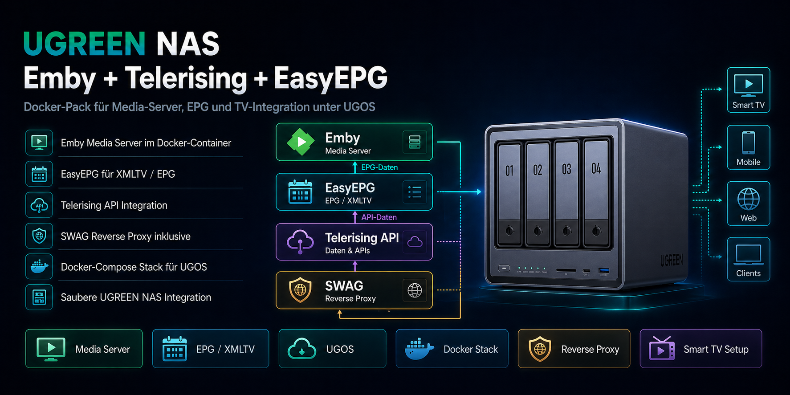

# Emby Telerising EasyEPG DockerPack für UGREEN NAS

[](https://github.com/Railsimulatornet/UGREEN-NAS-Emby-Telerising-EasyEPG-DockerPack/actions/workflows/compose-validation.yml)
[](LICENSE)



[Deutsch](#deutsch) · [English](#english)

## Deutsch

Docker-Projekt für **UGREEN NAS mit UGOS Pro**: Emby Media Server, SWAG als Reverse Proxy, EasyEPG und Telerising. Die deutschen und englischen Pakete enthalten dieselbe Konfiguration mit übersetzten Kommentaren und einem passenden PDF-Handbuch.

### Funktionen

- Emby für Medien und Live-TV.
- SWAG mit HTTPS und vorkonfiguriertem Fail2Ban-Anmeldefilter.
- EasyEPG für XMLTV-Programmdaten und Telerising für Live-TV-Streams.
- Zentrale `.env` für Hostpfade, Ports, Domain und Benutzerrechte.

### Voraussetzungen

- UGREEN NAS mit Docker-App oder Docker Compose.
- Passende Medienordner und Benutzerrechte auf der NAS. Die mitgelieferte Compose-Datei bindet `/dev/dri` für die Hardwarebeschleunigung ein; das Gerät muss auf deinem System vorhanden sein.
- Für den externen Zugriff: eigene Domain, passende DNS-Einträge und Routerfreigaben für SWAG.

### Schnellstart

1. Lade aus dem [aktuellen Release](https://github.com/Railsimulatornet/UGREEN-NAS-Emby-Telerising-EasyEPG-DockerPack/releases/latest) die ZIP mit Endung `_de.zip` oder `_en.zip` herunter.
2. Entpacke sie nach `/volume2/docker/`. Der Projektordner liegt dann unter `/volume2/docker/embyserver/`.
3. Bearbeite `embyserver/.env`. Setze `DOCKER_DIR` auf den tatsächlichen Projektpfad und passe die unten aufgeführten Werte an.
4. Importiere den Ordner `embyserver` in der UGREEN Docker-App unter **Projekte → Importieren** und starte das Projekt.
5. Öffne Emby unter `http://<NAS-IP>:8096`. Verwende deinen angepassten Port, falls du den Standard geändert hast.

Alternativ per SSH im Projektordner:

```bash
cd /volume2/docker/embyserver
docker compose --env-file .env config --quiet
docker compose up -d
```

Wenn du aus dem Repository installierst, kopiere `de/embyserver/` oder `en/embyserver/` einschließlich `.env` und SWAG-Konfiguration an diesen Zielort.

### Konfiguration

| Bereich | Werte in `.env` |
|---|---|
| Projekt und Medien | `DOCKER_DIR`, `MEDIA_DIR`, `EMBY_SYSTEM_DIR`, `EMBY_BACKUP_DIR` |
| Benutzerrechte | `PUID`, `PGID`, `EMBY_UID`, `EMBY_GID`, `EMBY_GIDLIST` |
| SWAG | `SWAG_URL`, `SWAG_SUBDOMAINS`, `SWAG_EMAIL`, `SWAG_FAIL2BAN_ENABLED` |
| EasyEPG und Telerising | `USER_ID`, `GROUP_ID`, `TELERISING_UID`, `TELERISING_GID`, jeweilige Update-Einstellungen |
| Zeitzone | `TZ` |

Die Standardwerte für Benutzer und Gruppen müssen zu den Zugriffsrechten deiner Ordner passen. Die vollständige Vorlage findest du in [de/embyserver/.env](de/embyserver/.env).

#### Standardports

| Dienst | NAS-Port | Verwendung |
|---|---|---|
| Emby | `8096/tcp` | Lokale Weboberfläche |
| Emby Discovery | `7359/udp` | Erkennung im Netzwerk |
| SWAG HTTP | `5080/tcp` | Weiterleitung auf Container-Port 80 |
| SWAG HTTPS | `50443/tcp` | Weiterleitung auf Container-Port 443 |
| Emby-Proxy in SWAG | `8920/tcp` | Mitgelieferter Emby-HTTPS-Listener |
| Zusätzliche SWAG-Portabbildung | `58080/tcp` | Container-Port 8080; benötigt einen passenden Listener |
| EasyEPG | `4000/tcp` | Weboberfläche |
| Telerising | `5000/tcp` | API und Weboberfläche |

#### Reverse Proxy

Die mitgelieferte [Emby-Proxydatei](de/embyserver/linuxserver_swag/config/nginx/proxy-confs/emby.subdomain.conf) lauscht auf **8920** und verwendet `emby.*` als Servernamen. Setze dazu deine Domain in `.env` und behalte die Subdomain `emby` bei oder passe auch die Proxydatei an.

Bei unveränderter Konfiguration ist der HTTPS-Zugriff über `https://emby.example.com:8920` möglich, sofern DNS und Erreichbarkeit passen. Für die externe URL ohne Portangabe leite Router-Port **443 auf NAS-Port 8920** weiter. Router-Port **80** führt auf den konfigurierten SWAG-HTTP-Port, standardmäßig **5080**. Wenn du Ports änderst, passe die Weiterleitungen entsprechend an.

### Aktualisierung

Sichere deine Konfiguration und behalte die angepasste `.env`, Compose-Datei und Containerdaten. Aktualisiere die Images in der Docker-App oder im Projektordner:

```bash
docker compose pull
docker compose up -d
```

Übernimm Änderungen aus einem neuen Paket gezielt in deine vorhandene Konfiguration.

### Projektstruktur und Dokumentation

| Inhalt | Pfad |
|---|---|
| Deutsche Paketquelle | [de/embyserver/](de/embyserver/) |
| Englische Paketquelle | [en/embyserver/](en/embyserver/) |
| Handbuch Deutsch | [EmbyServer_Handbuch_DE_v1.pdf](de/EmbyServer_Handbuch_DE_v1.pdf) |
| Handbuch Englisch | [EmbyServer_Handbuch_EN_v1.pdf](en/EmbyServer_Handbuch_EN_v1.pdf) |

Der Workflow [Compose Validation](https://github.com/Railsimulatornet/UGREEN-NAS-Emby-Telerising-EasyEPG-DockerPack/actions/workflows/compose-validation.yml) baut ZIPs aus den eingecheckten DE-/EN-Paketquellen. Er entpackt sie, prüft die Compose-Konfigurationen und Anmeldefilter und stellt die geprüften Pakete mit Commit-SHA und Prüfsummen als CI-Artefakt bereit. Fertige Veröffentlichungen findest du unter **Releases**.

### Lizenz

[MIT-Lizenz](LICENSE). Roman Glos / Railsimulatornet.

## English

Docker project for **UGREEN NAS running UGOS Pro**: Emby Media Server, SWAG as a reverse proxy, EasyEPG and Telerising. The German and English packages provide the same configuration with translated comments and a matching PDF manual.

### Features

- Emby for media and live TV.
- SWAG with HTTPS and a preconfigured Fail2Ban authentication filter.
- EasyEPG for XMLTV programme data and Telerising for live TV streams.
- A central `.env` for host paths, ports, domain and user permissions.

### Requirements

- UGREEN NAS with the Docker app or Docker Compose.
- Suitable media folders and user permissions on the NAS. The supplied Compose file maps `/dev/dri` for hardware acceleration; this device must exist on your system.
- For external access: your own domain, suitable DNS records and router forwarding for SWAG.

### Quick start

1. Download the ZIP ending in `_en.zip` or `_de.zip` from the [latest release](https://github.com/Railsimulatornet/UGREEN-NAS-Emby-Telerising-EasyEPG-DockerPack/releases/latest).
2. Extract it into `/volume2/docker/`. The project will be at `/volume2/docker/embyserver/`.
3. Edit `embyserver/.env`. Set `DOCKER_DIR` to the actual project path and adjust the values listed below.
4. In the UGREEN Docker app, select **Projects → Import**, choose the `embyserver` folder and start the project.
5. Open Emby at `http://<NAS-IP>:8096`. Use your configured port if you changed the default.

Alternatively, run these commands over SSH from the project folder:

```bash
cd /volume2/docker/embyserver
docker compose --env-file .env config --quiet
docker compose up -d
```

When installing from the repository, copy `en/embyserver/` or `de/embyserver/`, including `.env` and the SWAG configuration, to this destination.

### Configuration

| Area | Values in `.env` |
|---|---|
| Project and media | `DOCKER_DIR`, `MEDIA_DIR`, `EMBY_SYSTEM_DIR`, `EMBY_BACKUP_DIR` |
| User permissions | `PUID`, `PGID`, `EMBY_UID`, `EMBY_GID`, `EMBY_GIDLIST` |
| SWAG | `SWAG_URL`, `SWAG_SUBDOMAINS`, `SWAG_EMAIL`, `SWAG_FAIL2BAN_ENABLED` |
| EasyEPG and Telerising | `USER_ID`, `GROUP_ID`, `TELERISING_UID`, `TELERISING_GID`, their respective update settings |
| Time zone | `TZ` |

The default user and group IDs must match the permissions of your folders. See [en/embyserver/.env](en/embyserver/.env) for the complete template.

#### Default ports

| Service | NAS port | Purpose |
|---|---|---|
| Emby | `8096/tcp` | Local web interface |
| Emby Discovery | `7359/udp` | Network discovery |
| SWAG HTTP | `5080/tcp` | Maps to container port 80 |
| SWAG HTTPS | `50443/tcp` | Maps to container port 443 |
| Emby proxy in SWAG | `8920/tcp` | Supplied Emby HTTPS listener |
| Additional SWAG port mapping | `58080/tcp` | Container port 8080; requires a matching listener |
| EasyEPG | `4000/tcp` | Web interface |
| Telerising | `5000/tcp` | API and web interface |

#### Reverse proxy

The supplied [Emby proxy file](en/embyserver/linuxserver_swag/config/nginx/proxy-confs/emby.subdomain.conf) listens on **8920** and uses `emby.*` as its server name. Set your domain in `.env` and keep the `emby` subdomain, or update the proxy file as well.

With the unchanged configuration, HTTPS is available at `https://emby.example.com:8920` when DNS and network access are configured accordingly. For an external URL without a port number, forward router port **443 to NAS port 8920**. Router port **80** points to the configured SWAG HTTP port, **5080** by default. Adjust forwarding if you change these ports.

### Updates

Back up your configuration and keep your customised `.env`, Compose file and container data. Update the images in the Docker app or from the project folder:

```bash
docker compose pull
docker compose up -d
```

Apply changes from a new package selectively to your existing configuration.

### Project structure and documentation

| Content | Path |
|---|---|
| German package source | [de/embyserver/](de/embyserver/) |
| English package source | [en/embyserver/](en/embyserver/) |
| German manual | [EmbyServer_Handbuch_DE_v1.pdf](de/EmbyServer_Handbuch_DE_v1.pdf) |
| English manual | [EmbyServer_Handbuch_EN_v1.pdf](en/EmbyServer_Handbuch_EN_v1.pdf) |

The [Compose Validation](https://github.com/Railsimulatornet/UGREEN-NAS-Emby-Telerising-EasyEPG-DockerPack/actions/workflows/compose-validation.yml) workflow builds ZIPs from the committed DE/EN package sources. It extracts them, checks the Compose configurations and authentication filters, and provides the checked packages with their commit SHA and checksums as a CI artifact. Published packages are available under **Releases**.

### License

[MIT License](LICENSE). Roman Glos / Railsimulatornet.
